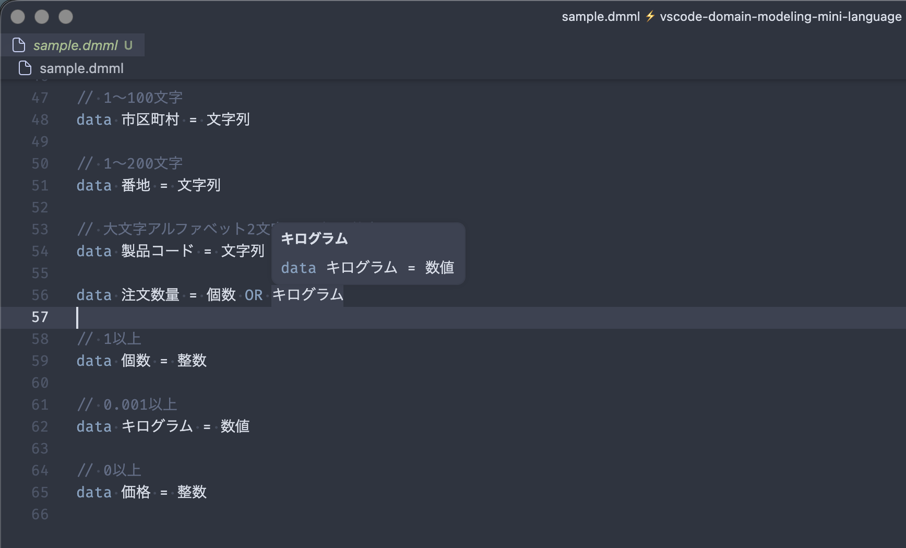

# vscode-domain-modeling-mini-language

VSCode拡張機能。Domain Model Mini Languageで書かれた`.dmml`ファイルのシンタックスハイライトとランゲージサポートを提供します。



## 動作確認手順

### ビルド

```bash
npm run compile
```

開発中は自動再コンパイルを利用すると便利です：

```bash
npm run watch
```

### Extension Development Host で起動

VSCodeでこのフォルダを開いた状態で **F5** を押すと、拡張機能がロードされた新しいVSCodeウィンドウ（Extension Development Host）が起動します。

コマンドラインから起動する場合：

```bash
code --extensionDevelopmentPath=/path/to/vscode-domain-modeling-mini-language
```

### 動作確認

起動したExtension Development Hostウィンドウで：

1. `sample.dmml` を開く
2. シンタックスハイライトが正しく適用されているか確認
3. コマンドパレット（`Cmd+Shift+P`）→「Developer: Inspect Editor Tokens and Scopes」でトークンのスコープを確認

### ログ確認

- 「Help」→「Toggle Developer Tools」→ Consoleタブでエラーを確認
- 「Output」パネル →「Extension Host」チャネルで拡張のログを確認
